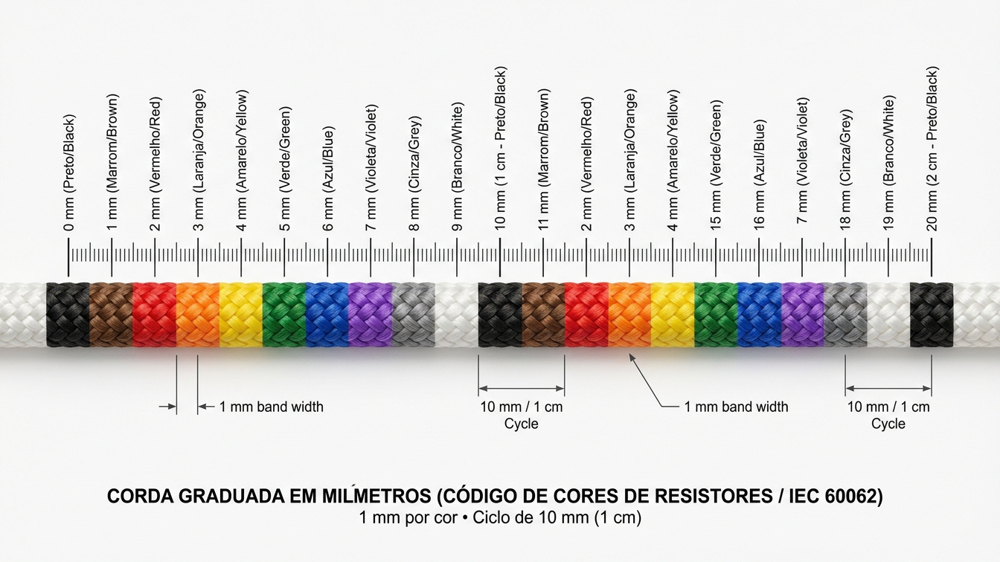

# Corda Graduada por Código de Cores (IEC 60062)

**Autor:** Luiz Augusto Prado 1807787 (UNB)  
**Blog:** https://sirmathmiracle.blogspot.com/2026/11/corda-graduada.html?m=1
**Data:** Novembro de 2026  

## Descrição

Para operarmos o **Trisseccionador e N-Seccionador de Ângulos** apresentado anteriormente, utilizamos uma corda graduada milimetricamente segundo o padrão internacional de código de cores de resistores (**IEC 60062**). 

Cada faixa colorida possui largura exata de **1 mm**, formando ciclos contínuos de **10 mm (1 cm)** de **0 (Preto)** a **9 (Branco)**, o que permite leitura visual direta da variação de perímetro e da posição angular sem necessidade de instrumentos eletrônicos.

## Escala de Cores (Ciclo de 10 mm)

| Dígito (mm) | Cor |
| :---: | :--- |
| **0** | Preto |
| **1** | Marrom |
| **2** | Vermelho |
| **3** | Laranja |
| **4** | Amarelo |
| **5** | Verde |
| **6** | Azul |
| **7** | Violeta |
| **8** | Cinza |
| **9** | Branco |

## Licença — Domínio Público

Este projeto e suas especificações técnicas são dedicados ao **Domínio Público Universal** sob a licença **Creative Commons Zero (CC0 1.0)**. Nenhuma patente ou restrição de direitos autorais se aplica.

